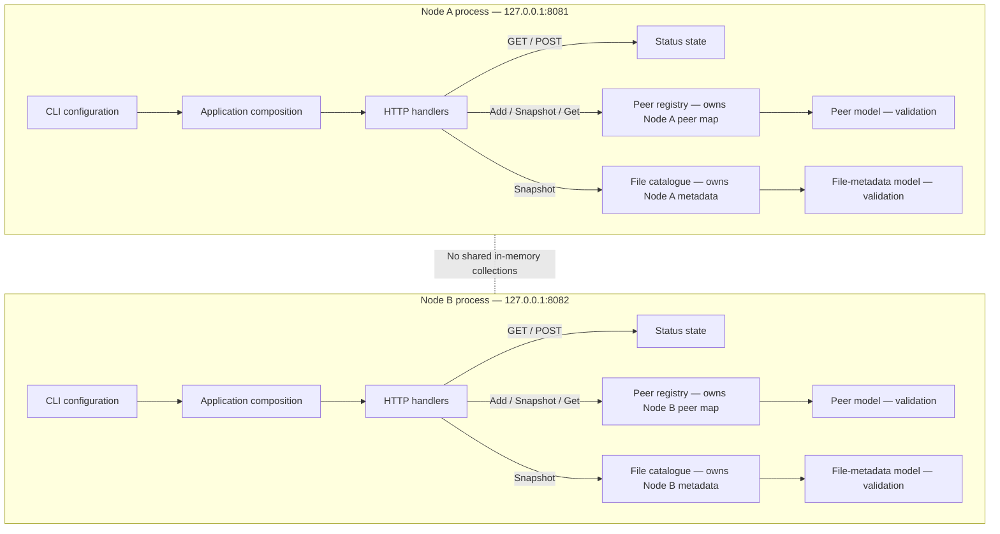

# Week 3 Architecture — Peer Registry and File Catalogue

## 1. Overview

Week 3 extends the existing Go application with peer registration and file metadata. The project continues to use one Go module and keeps the earlier Week 1 and Week 2 features.

Node A uses the loopback HTTP address `127.0.0.1:8081`. Node B uses `127.0.0.1:8082`.

## Architecture diagram

The diagram shows the arrangement inside each node. Node A and Node B are separate processes, so their registries and catalogues are not shared.

Each process owns its own mutable state. The registry protects its peer map with a lock, while the catalogue protects its metadata collection with a lock. HTTP handlers access this state through the registry and catalogue methods.

## 2. Main components

- `internal/model`: Defines and validates peer and file metadata.
- `internal/state/registry.go`: Stores peers in a map protected by `sync.RWMutex`.
- `internal/state/catalog.go`: Stores file metadata and safely replaces the catalogue.
- `internal/httpapi/peers.go`: Provides the `/v1/peers` and `/v1/files` endpoints.
- `internal/app/stage.go`: Creates state objects, loads seed files and connects HTTP handlers.
- `testdata`: Contains sample peer data and separate file metadata for each node.

## 3. HTTP endpoints

| Endpoint | Method | Purpose |
|---|---|---|
| `/healthz` | GET | Checks whether the node is running |
| `/v1/status` | GET, POST | Reads or updates node status |
| `/v1/peers` | GET | Lists registered peers |
| `/v1/peers` | POST | Registers a peer |
| `/v1/files` | GET | Lists file metadata |

Successful peer registration returns `201 Created`. A duplicate peer ID returns `409 Conflict`. Invalid peer data returns `400 Bad Request`, and unsupported methods return `405 Method Not Allowed`.

## 4. Concurrency and shared state

The peer registry uses `sync.RWMutex`. Adding a peer holds a write lock while checking for a duplicate ID and inserting the peer. This prevents concurrent requests from registering the same ID.

Read operations use a read lock. The registry returns a new slice sorted by peer ID, so callers cannot change the registry by modifying the returned snapshot.

The catalogue validates all replacement metadata before changing its stored data. It copies and sorts the candidate list by filename. If validation fails, the previous catalogue remains unchanged. Snapshots are independent copies.

## 5. Seed data and process boundaries

Node A loads `testdata/node-a-files.json`, which contains `alpha.txt`. Node B loads `testdata/node-b-files.json`, which contains `diagram.txt` and `notes.txt`.

Each node has its own in-memory registry and catalogue. They do not share Go memory. Peer registration records information about a peer; it does not prove that the peer is reachable.

## 6. Validation and limitations

Peer metadata is checked for a valid ID, loopback addresses and a supported status. File metadata is checked for a safe filename, non-negative size and modification time, and a correctly formatted SHA-256 value.

The application stores file metadata, not file contents. A valid-looking hash does not prove that a file exists or matches that hash. Peer status is explicitly recorded and is not automatically updated by heartbeats or gossip.

The service has no authentication. It is intended for local coursework testing on loopback addresses, not public exposure.

## 7. Verification

The following checks passed during Week 3 development:

- `go test ./... -count=1 -timeout 20s`
- `go vet ./...`
- `go test -race ./... -count=1 -timeout 30s`
- Node A and Node B returned HTTP 200 from `/v1/files`.
- Registering Node B returned HTTP 201, and repeating the registration returned HTTP 409.
- `/v1/peers` listed Node B, and `/v1/status` continued to return `healthy`.